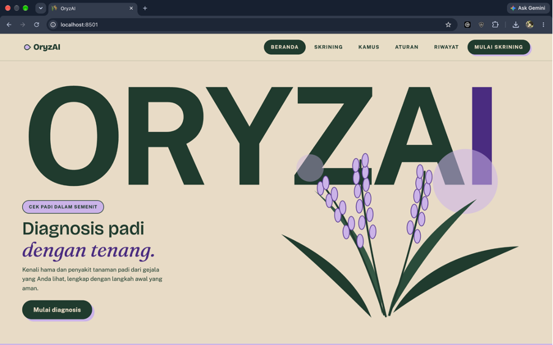
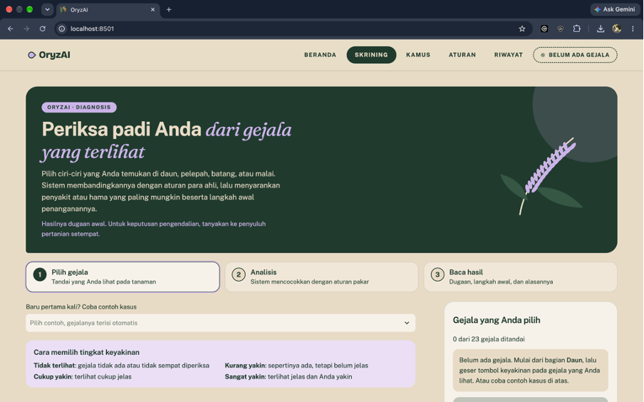
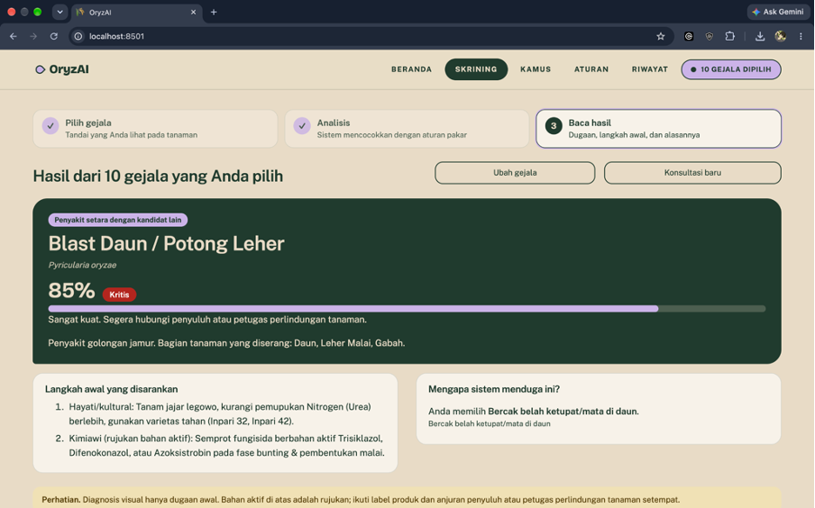

# OryzAI --- Sistem Pakar Diagnosis Hama dan Penyakit Padi

## 1. Deskripsi Sistem

OryzAI adalah aplikasi sistem pakar berbasis Python dan Streamlit untuk
membantu skrining awal hama dan penyakit tanaman padi. Sistem
menganalisis gejala yang dipilih pengguna menggunakan metode **Forward
Chaining** dan **Certainty Factor (CF)**, lalu menampilkan dugaan
diagnosis beserta penjelasan aturan yang digunakan.

OryzAI merupakan alat bantu skrining awal dan bukan pengganti diagnosis
dari pakar atau penyuluh pertanian.

## 2. Instalasi dan Menjalankan Aplikasi

Pastikan Python telah terpasang, lalu buka terminal pada folder proyek.

**Windows (PowerShell):**

``` powershell
python -m venv .venv
.\.venv\Scripts\Activate.ps1
pip install -r requirements.txt
streamlit run app.py
```

**macOS/Linux:**

``` bash
python3 -m venv .venv
source .venv/bin/activate
pip install -r requirements.txt
streamlit run app.py
```

Setelah perintah dijalankan, buka alamat lokal yang ditampilkan
Streamlit pada browser, biasanya `http://localhost:8501`.

Untuk menjalankan pengujian:

``` bash
python -m unittest discover -s tests -v
```

## 3. Fitur Sistem

-   **Konsultasi diagnosis:** memilih gejala dan tingkat keyakinan
    berdasarkan kondisi tanaman.
-   **Forward Chaining:** mencocokkan gejala dengan aturan IF--THEN
    dalam basis pengetahuan.
-   **Certainty Factor:** menghitung skor dukungan untuk kandidat
    diagnosis.
-   **Penjelasan hasil:** menampilkan aturan yang aktif dan alasan di
    balik hasil diagnosis.
-   **Kamus penyakit dan hama:** mencari informasi terkait diagnosis dan
    gejala.
-   **Kelola aturan:** menambah, mengubah, dan menghapus aturan pada
    basis pengetahuan.
-   **Riwayat konsultasi:** melihat riwayat dan mengunduh data
    konsultasi.

## 4. Screenshot

### Beranda



### Konsultasi dan pemilihan gejala



### Hasil diagnosis



### Kamus penyakit dan hama


### Kelola aturan


### Riwayat konsultasi


### Certainty Factor


### Forward Chaining


